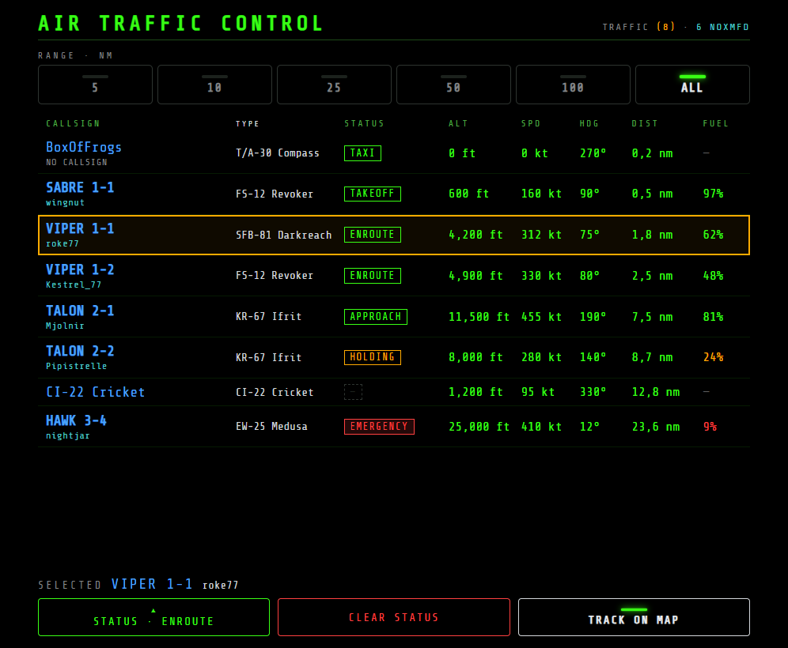
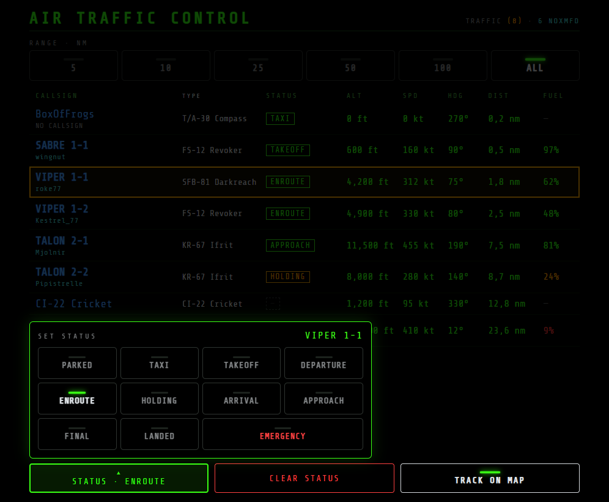

# NOXMFD Extension: ATC Module

[](https://github.com/roke77/NOXMFD)

[](LICENSE)

Adds an **ATC** page under [NOXMFD](https://github.com/roke77/NOXMFD)'s EXT nav — a
traffic-management / flight-progress MFD for a player acting as Air Traffic Control: the traffic
table (callsign with the pilot's Steam name, aircraft type, status, altitude, speed, heading,
distance and fuel), range presets that follow the game's Metric/Imperial setting, friendly traffic
only, an ATC Status assignment for the selected aircraft, a per-unit MAP status ring, and
select-to-LOCATE-ON-MAP (plus a TRACK ON MAP toggle that keeps MAP following the selected
aircraft).



Pick an aircraft, then **STATUS** opens a list of statuses to assign it:



Built entirely through NOXMFD's public extension API — see NOXMFD's
[`EXTENSIONS.md`](https://github.com/roke77/NOXMFD/blob/main/EXTENSIONS.md). This repo does
**not** modify NOXMFD's own source.

## Building

Requires a local Nuclear Option install with BepInEx 5 and NOXMFD already installed. Create a
gitignored `GameDir.props` next to the `.csproj` if your install isn't the default Steam path:

```xml
<Project><PropertyGroup>
  <GameDir>D:\SteamLibrary\steamapps\common\Nuclear Option</GameDir>
</PropertyGroup></Project>
```

Then:

```bash
dotnet build AtcModule.csproj -c Release
```

The build's `DeployToGame` target copies the built DLL straight into
`$(GameDir)\BepInEx\plugins\` for you.

## Installing

1. Install BepInEx 5 and [NOXMFD](https://github.com/roke77/NOXMFD).
2. Drop `NOXMFD.AtcModule.dll` into `BepInEx/plugins/`.
3. Launch the game — an **ATC** entry appears under NOXMFD's EXT nav.
